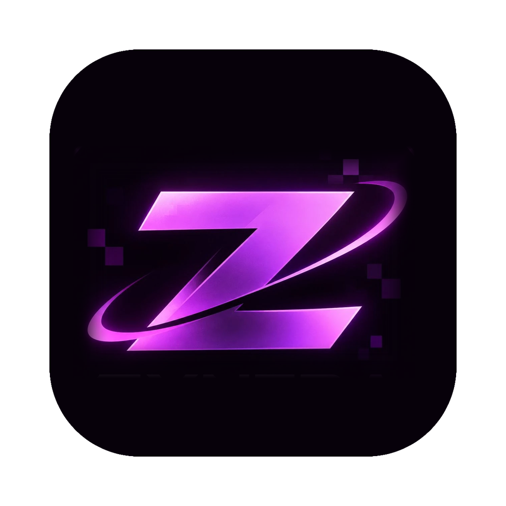

<p align="center">
  
</p>

<h1 align="center">Zyntra Launcher</h1>

<p align="center">
  Лёгкий лаунчер Minecraft без рекламы, написанный на Rust.<br>
  Все версии Minecraft, игра без аккаунта Microsoft, моды, шейдеры, скины — и Horizon, Minecraft 26.3, переписанный на Rust.
</p>

<p align="center">
  <a href="https://github.com/ghoperfifj-art/Zyntra-launcher-/releases/latest/download/ZyntraSetup-Windows.exe"><b>⬇ Скачать для Windows</b></a>
  &nbsp;·&nbsp;
  <a href="https://github.com/ghoperfifj-art/Zyntra-launcher-/releases/latest/download/ZyntraLauncher-macOS.dmg"><b>⬇ Скачать для Mac (M1 и новее)</b></a>
</p>

---

## Установка

### Windows
1. Скачай **[ZyntraSetup-Windows.exe](https://github.com/ghoperfifj-art/Zyntra-launcher-/releases/latest/download/ZyntraSetup-Windows.exe)**.
2. Запусти и нажми «Установить». Права администратора не нужны.
3. Если Windows покажет «Система Windows защитила ваш компьютер» — «Подробнее» → «Выполнить в любом случае».

### Mac (Apple M1, M2, M3, M4)
1. Скачай **[ZyntraLauncher-macOS.dmg](https://github.com/ghoperfifj-art/Zyntra-launcher-/releases/latest/download/ZyntraLauncher-macOS.dmg)**.
2. Открой его и перетащи **Zyntra Launcher** в папку **«Программы»**.
3. Первый запуск: правый клик по Zyntra Launcher в «Программах» → **«Открыть»** → «Открыть».
   На macOS 15 и новее: запусти один раз, затем **Системные настройки → Конфиденциальность и безопасность → «Всё равно открыть»**.
   Это нужно один раз: у лаунчера нет платной подписи Apple.

## Возможности

- **Все версии Minecraft** — релизы, снапшоты, Beta/Alpha, Fabric; видит версии из TLauncher (Forge, OptiFine и др.).
- **Без аккаунта Microsoft** — офлайн-профиль с любым ником.
- **Память подбирается сама** под объём ОЗУ компьютера, можно настроить вручную.
- **Скины** — выбор PNG, 3D-модель, которую можно вращать; скин виден в игре во всех версиях.
- **Моды и шейдеры** из каталога Modrinth, установка в один клик с зависимостями.
- **Horizon 26.3** — Minecraft Java Edition, переписанный на Rust: быстро запускается и работает на слабых ПК.
- **Horizon OptiFine** — тот же Horizon с Zyntra Fine (настройки в стиле OptiFine), зумом, динамическим светом, шейдерами OptiFine/Iris и нативными модами (Freecam, Minimap и другие).
- **Xray** ресурс-пак и мод **Zyntra Crystals** для Horizon.
- Лаунчер прячется, пока идёт игра, и возвращается после выхода.

## Где хранятся файлы

| | Windows | Mac |
|---|---|---|
| Игра, версии, миры | `D:\Zlauncher\minecraft` (или `%APPDATA%\.zyntra`, если нет диска D) | `~/Library/Application Support/Zyntra Launcher/minecraft` |
| Настройки | `zyntra.json` рядом с лаунчером | `~/Library/Application Support/Zyntra Launcher/zyntra.json` |

На Mac версии 1.19 и новее запускаются нативно на Apple Silicon; более старые — через Rosetta, как в официальном лаунчере.

## Сборка из исходников

Нужен [Rust](https://rustup.rs).

```bash
cargo build --release
```

- Установщик Windows: `installer/build.ps1` (нужен [Inno Setup 6](https://jrsoftware.org/isinfo.php)).
- Приложение и `.dmg` для Mac: `bash macos/build-app.sh` (на Mac).
- Релиз: тег `v*` (например `git tag v0.1.0 && git push --tags`) — GitHub Actions соберёт обе версии и выложит их в Releases.

---

Zyntra Launcher — неофициальный проект, не связан с Mojang Studios и Microsoft. Minecraft — торговая марка Mojang и Microsoft.
Horizon — сторонний проект [horizon-rust/horizon](https://github.com/horizon-rust/horizon).
